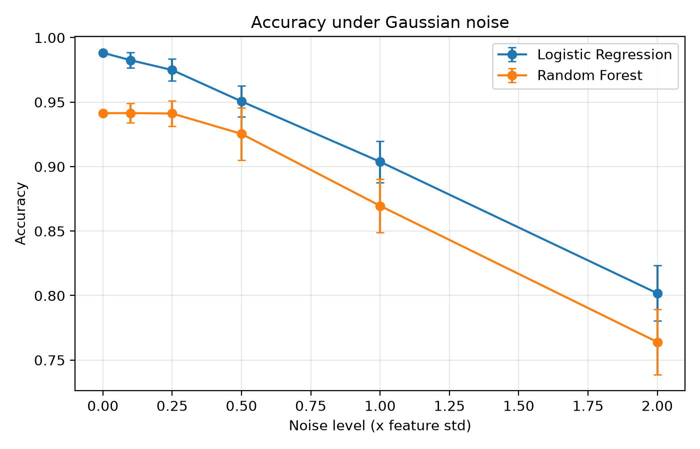
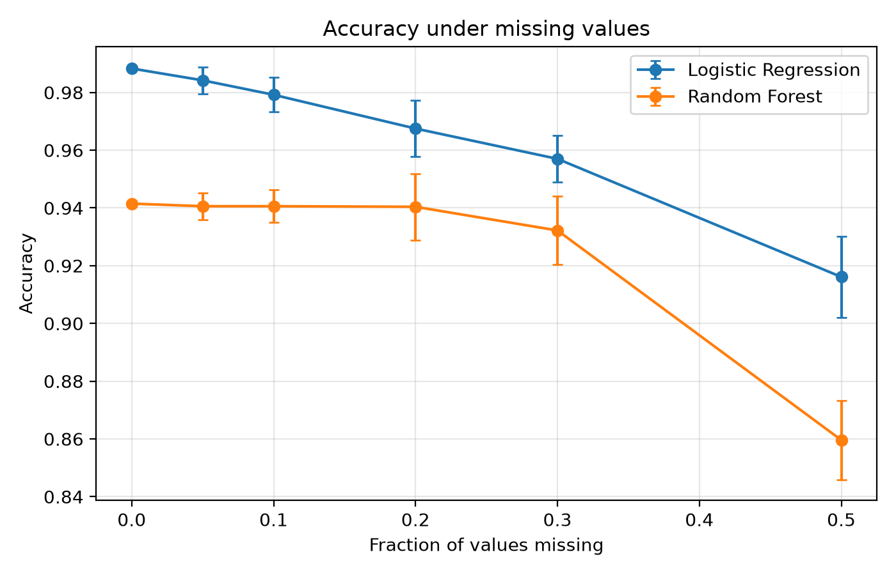
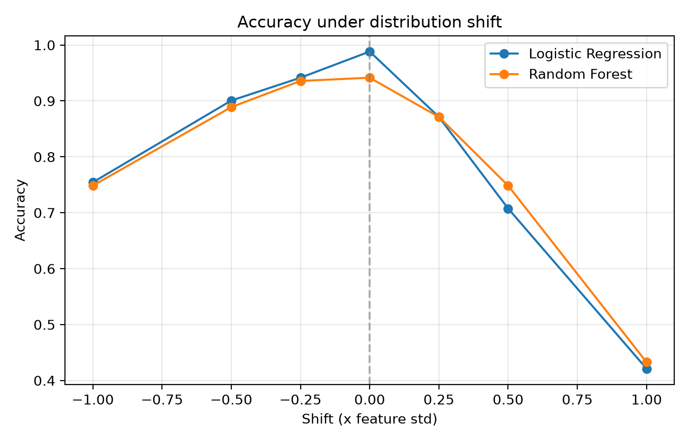
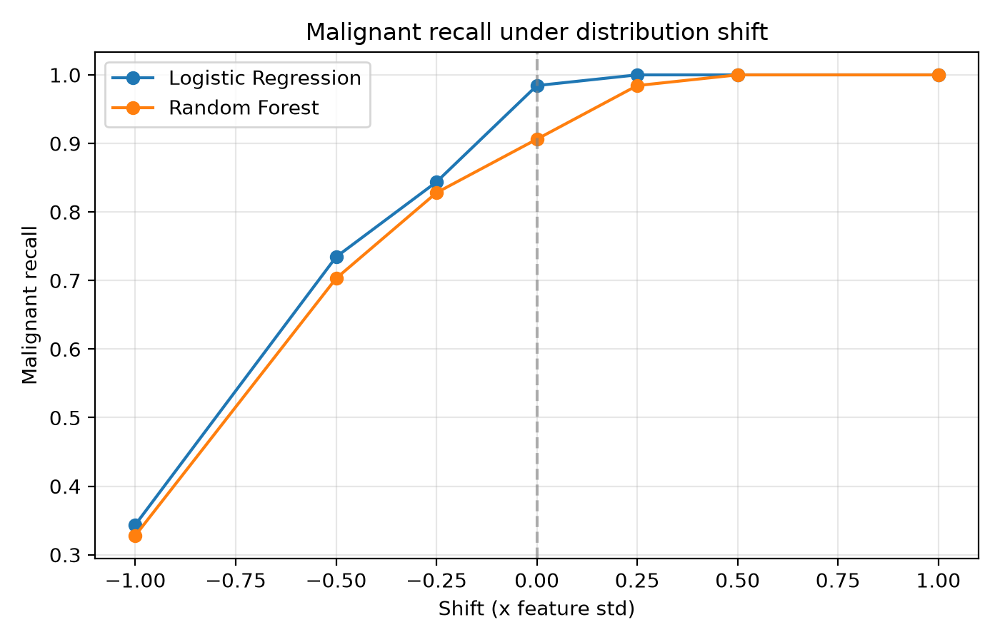

# Machine Learning Robustness Testing Lab

How much does a classifier's performance drop when test data is noisy, incomplete, or systematically different from the training data?

This project trains two classifiers on the Breast Cancer Wisconsin dataset (scikit-learn, 569 samples, 30 features) and stress-tests them with three kinds of data degradation. Models are trained once on clean data and evaluated only on degraded test data.

## Models
- Logistic Regression (with StandardScaler)
- Random Forest (200 trees)

Clean baseline: Logistic Regression 0.9883 accuracy, Random Forest 0.9415 (70/30 stratified split, seed 42).

## Tests
| Test | What is changed | Levels |
|---|---|---|
| Gaussian noise | Random noise added to test features, scaled by each feature's std | 0 to 2.0 std, 20 repeats each |
| Missing values | Random values removed, filled with training means | 0% to 50%, 20 repeats each |
| Distribution shift | Every feature shifted by a fixed multiple of its std | -1.0 to +1.0 std |

## Key findings
1. **Random Forest degrades more gracefully under mild corruption.** At 0.25 std noise it loses about 0.03 points, versus 1.3 for Logistic Regression. With 20% of values missing it loses 0.1 points, versus 2.1.
2. **Logistic Regression has higher absolute accuracy at every noise and missing-value level**, so "more robust" depends on whether you measure the size of the drop or the final score.
3. **Heavy corruption hurts both models.** At 2.0 std noise accuracy falls to 0.80 (LR) and 0.76 (RF). At 50% missing, Random Forest falls to 0.86, below Logistic Regression's 0.92.
4. **Distribution shift is asymmetric and dangerous.** Shifting features down by 1 std cuts malignant recall to about 0.33 for both models, so roughly two thirds of cancers are missed. Shifting up gives recall of 1.0, but only because the models flag almost everything as malignant (accuracy falls to about 0.42).

## Charts





## Limitations
- One small dataset and one train/test split (171 test rows, so one sample is about 0.6%).
- Default hyperparameters, no tuning.
- Distribution shift moves all 30 features together, which is harsher than most real drift.
- Mean imputation is the only missing-value strategy tested.
- Explanations for why the models behave this way (such as correlated features helping Random Forest) are hypotheses, not tested here.

## Run it
```bash
python -m venv venv
venv\Scripts\activate        # Windows
pip install -r requirements.txt
python src/baseline.py
python src/noise_test.py
python src/missing_test.py
python src/shift_test.py
python src/make_charts.py
```

## Project structure
```
src/       common.py, baseline.py, noise_test.py, missing_test.py, shift_test.py, make_charts.py
results/   CSV output of every test
charts/    PNG charts
```
